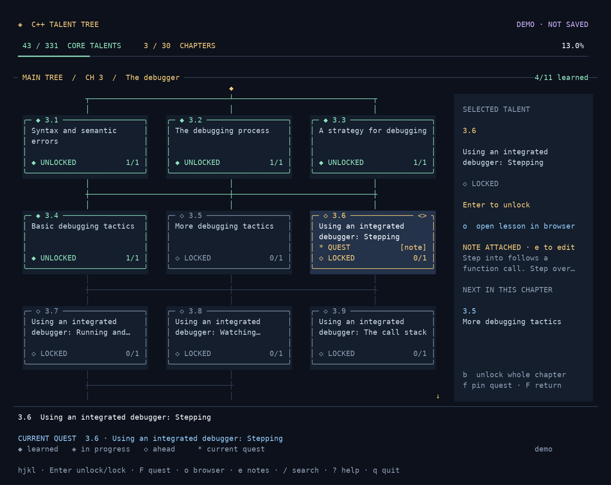

# C++ Talent Tree

**Your LearnCpp progress, as a terminal talent tree.**

Work through lessons, unlock talents, keep notes, and return to your current quest
without leaving the keyboard. Built for learners who enjoy Vim navigation—and
for anyone who wants to make their progress visible on stream.

**Python 3.10+ · Linux / macOS · No runtime packages · MIT**

[Install](#install) · [First run](#first-run) · [Keys](#keys) · [Streaming](#streaming)
· [Uninstall](#uninstall) · [Contribute](CONTRIBUTING.md)



*Rendered from the app's demo mode. Try it with `cpp-tree --demo`.*

## What it does

- **Track the path:** 356 lesson entries across 35 chapters, with separate main,
  side-quest, and archive views. The main path contains 331 entries.
- **Stay on your quest:** pin a lesson with `f`; return to it with `F`.
- **Make it yours:** save lesson and chapter notes, search titles or lesson IDs,
  and open the selected article in your default browser.
- **Keep progress safe:** automatic saves, a previous-save backup, and undo/redo
  for completion changes within the current session.
- **Share your progress:** stream view hides note contents and controls; a small
  `stream.txt` file gives OBS your current chapter and lesson.

The tracker works offline. Opening an article needs an internet connection.
The branches are visual guides: you can mark any lesson complete, with no enforced
prerequisites. “Unlocking” records your progress; it does not unlock website access.

This is an independent companion to [LearnCpp](https://www.learncpp.com/), not an
official LearnCpp project. It bundles an outline, not the tutorials. The outline
is a snapshot and may differ from the live site; see [attribution](NOTICE.md).

## Install

You need **Python 3.10 or newer with `curses`**, plus `curl` for the command below.
The app targets Linux and macOS. On Windows, use a Linux distribution inside WSL;
native Windows is not supported. Python must be available as `python3`.

```sh
curl -fsSL https://raw.githubusercontent.com/RidaCode/cpp-tree/main/install.sh | sh
```

Then launch:

```sh
cpp-tree
```

The installer builds a single executable at `~/.local/bin/cpp-tree`. It needs no
`sudo`, pip packages, or virtual environment. It does not edit your shell settings
or touch your progress. It downloads the current `main` branch of this repository.

**Command not found?** Run `~/.local/bin/cpp-tree` directly, or add this line to your
shell configuration (`~/.bashrc` for Bash or `~/.zshrc` for Zsh), then reopen the terminal:

```sh
export PATH="$HOME/.local/bin:$PATH"
```

<details>
<summary>Inspect the installer, install from source, or choose another location</summary>

Download and inspect the script before running it:

```sh
curl -fsSL https://raw.githubusercontent.com/RidaCode/cpp-tree/main/install.sh -o install.sh
less install.sh
sh install.sh
```

From a downloaded or cloned repository, installation is one command:

```sh
python3 scripts/install.py
```

Use a different executable directory:

```sh
python3 scripts/install.py --bin-dir "$HOME/bin"
```

Or pass `CPP_TREE_BIN_DIR` to the online installer:

```sh
curl -fsSL https://raw.githubusercontent.com/RidaCode/cpp-tree/main/install.sh | CPP_TREE_BIN_DIR="$HOME/bin" sh
```

You can also run the source checkout without installing anything:

```sh
python3 -m cpp_tree
```

Contributors may install it into a virtual environment with `python3 -m pip install -e .`.
The project does not need to be published on PyPI for any of these methods.

</details>

## First run

1. Open `cpp-tree`, or try `cpp-tree --demo` without reading or changing your saves.
2. Move with `h j k l` or the arrow keys. Press `Enter` to open a chapter.
3. Press `o` to open a lesson. When you finish it, press `Enter` to mark it complete.
4. Press `f` to pin your current lesson, and `F` whenever you want to return to it.
5. Press `e` for notes, `Ctrl-S` to save them, and `q` to quit the tree.

Use a terminal at least **72 columns × 22 rows**. A larger window shows more of the
tree; the detail sidebar appears at 118 columns. Press `?` for the in-app key guide.

## Keys

### Tree and lessons

| Key | Action |
| --- | --- |
| `h j k l` / arrows | Move between nodes; up/down move one grid row |
| `Enter` / `Space` | Open a chapter, or toggle lesson completion |
| `Esc` / `Backspace` | Return to the chapter map |
| `o` | Open the lesson in your browser; on a chapter, open its next incomplete lesson |
| `/` | Search all lessons by title or ID |
| `f` / `F` | Pin a lesson / return to your pinned lesson |
| `n` | Go to the next incomplete node in the current view |
| `e` / `E` | Edit the selected lesson's notes / its chapter's notes |
| `b` | Toggle a whole chapter, after confirmation |
| `u` / `r` or `Ctrl-R` | Undo / redo completion changes in this session |
| `Tab` / `Shift-Tab` | Switch between main, side quests, and archive |
| `[` / `]` | Previous / next chapter |
| `gg` / `G` | First / last node |
| `Ctrl-D` / `Ctrl-U` | Page down / up |
| `s` | Toggle stream view |
| `?` | Show help |
| `q` | Save the current view and quit |

### Search and notes

| Context | Key | Action |
| --- | --- | --- |
| Search | Arrows / `Ctrl-N` / `Ctrl-P` | Select a result |
| Search | `Enter` | Jump to the result in the tree |
| Search | `Ctrl-O` | Open the result in your browser |
| Search | `Ctrl-F` | Return to the pinned quest |
| Search | `Ctrl-U` | Clear the query |
| Notes | `Ctrl-S` | Save and close |
| Notes | `Enter` / arrows | New line / move the cursor |
| Search or notes | `Esc` | Cancel; unsaved note edits are discarded |

Notes support up to 20,000 characters each. Completion autosaves immediately;
**note edits save when you press `Ctrl-S`**. Undo/redo applies to completion changes,
not notes or quest pins, and resets when you close the app.

## Command-line options

```sh
cpp-tree --demo                    # Try sample progress without touching your files
cpp-tree --name "C++ ADVENTURER"    # Set a remembered display name
cpp-tree --stream                  # Start with notes and controls hidden
cpp-tree --summary                 # Read-only progress summary; no terminal needed
cpp-tree --state-path              # Print the active progress file location
cpp-tree --state ~/study/cpp/progress.json  # Use a separate profile
cpp-tree --color truecolor         # Force the full RGB palette
cpp-tree --color 256               # Use indexed terminal colors
cpp-tree --ascii                   # Use ASCII borders and symbols
cpp-tree --version
cpp-tree --help
```

A separate profile should have its own directory: `stream.txt` is written next to
its progress file. `--stream` hides note text, but names, lesson titles, progress,
and note indicators can still appear on screen.

## Your progress

The default location is:

```text
~/.local/state/cpp-tree/progress.json
```

If `XDG_STATE_HOME` is an absolute path, the location is
`$XDG_STATE_HOME/cpp-tree/progress.json`. `--state` overrides either default.
Use `cpp-tree --state-path` to see the path on your machine.

| File | Purpose |
| --- | --- |
| `progress.json` | Completed lesson IDs, notes, pinned quest, name, and last view |
| `progress.json.bak` | The previous successful save, replaced on each subsequent save |
| `progress.json.lock` | Prevents two app instances from writing the same profile |
| `stream.txt` | Current chapter and lesson for an OBS text source |

The app replaces saves atomically and refuses to silently reset malformed data.
An existing `.lock` file is normal: the operating system releases the lock when
the app exits. `--summary` can read the file while the app is open.

**Back up:** close the app and copy its state directory somewhere safe. This
single previous-save backup is not a long-term backup history.

**Restore:** close every instance, copy the damaged file aside, then copy a known
good backup over the progress file. See [troubleshooting](docs/troubleshooting.md)
for exact commands and custom paths.

### Moving from the old single-file script

The state path, version-1 JSON format, lesson keys, notes, and quest pins are
compatible with the original `cpp-tree-dev.py` / `cpp-tree.py` script. No import or
reset is needed. Keep using the same `--state` argument if you used a custom file.

If the installer finds an older script at `~/.local/bin/cpp-tree`, it refuses to
overwrite it. After confirming that is your old tracker, rename it, then install:

```sh
mv -i "$HOME/.local/bin/cpp-tree" "$HOME/.local/bin/cpp-tree.legacy"
python3 scripts/install.py
```

Run that install command from this repository, or rerun the online install
command. Existing aliases or shell functions named `cpp-tree` can also mask the
new command; check with `type -a cpp-tree`.

## Streaming

Start with `cpp-tree --stream`, or press `s` inside the app. Note contents and the
normal control footer are hidden. The app still responds to the same tree keys.

For an OBS text source, enable **Read from file** and choose `stream.txt` next to
your progress file. With the default state location, that is:

```text
~/.local/state/cpp-tree/stream.txt
```

The file contains two lines: the chapter title and the lesson title. It uses your
pinned quest, or the first incomplete main-path lesson when no valid quest is
pinned. It updates when you start the app and after a successful save. It contains
no notes. Demo mode never writes it. The pinned quest stays pinned after completion;
press `f` on your next lesson to change it.

## Update

Close the app and rerun the install command. The installer verifies the new
archive before atomically replacing its executable. Your state files remain in
place. From a checkout, update the checkout and run `python3 scripts/install.py`.

## Uninstall

For the one-command or source-script installer:

```sh
cpp-tree --uninstall
```

If it is not on your PATH, use `~/.local/bin/cpp-tree --uninstall`.

This removes the executable and **keeps your progress, notes, backups, and OBS text
file**. No administrator privileges are needed. To erase those files too, note
the location with `cpp-tree --state-path` before uninstalling, close the app, and
remove the files listed in [Your progress](#your-progress). Custom profiles must
be removed separately.

For a pip install, use `python3 -m pip uninstall cpp-tree` inside the same
environment; for pipx, use `pipx uninstall cpp-tree`. An uninstalled source
checkout can simply be deleted. Remove any PATH line or legacy executable you
added manually only if you no longer need it.

## Contribute

Small, focused contributions are welcome: bug reports, documentation improvements,
lesson-link corrections, and fixes for terminal behavior. Start with
[CONTRIBUTING.md](CONTRIBUTING.md), then see the [architecture](docs/architecture.md).

```sh
python3 -m unittest discover -s tests -v
```

The application and tests use the Python standard library. Formatting and linting
use the optional tool in `requirements-dev.txt`. See the [code of conduct](CODE_OF_CONDUCT.md)
and [security policy](SECURITY.md) before reporting sensitive issues.

## License and credits

Project code and original documentation are licensed under the [MIT License](LICENSE).
Created by [RidaCode](https://github.com/RidaCode).

Thanks to the authors of [LearnCpp](https://www.learncpp.com/) for the learning
material this tracker points to. Tutorial content remains with its authors; see
[NOTICE.md](NOTICE.md). Project setup follows the practical guidance in
[Open Source Guides](https://opensource.guide/).
